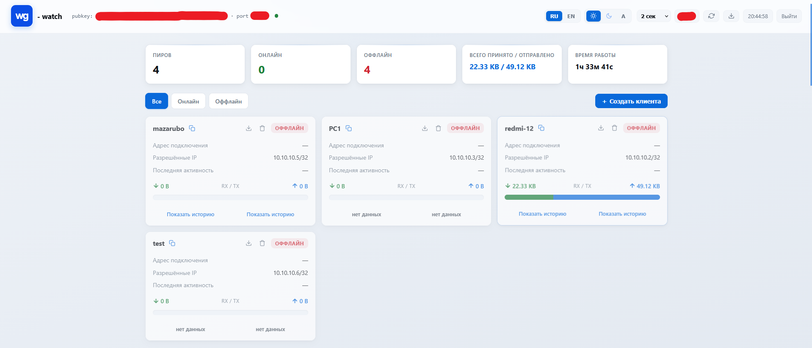
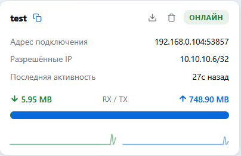
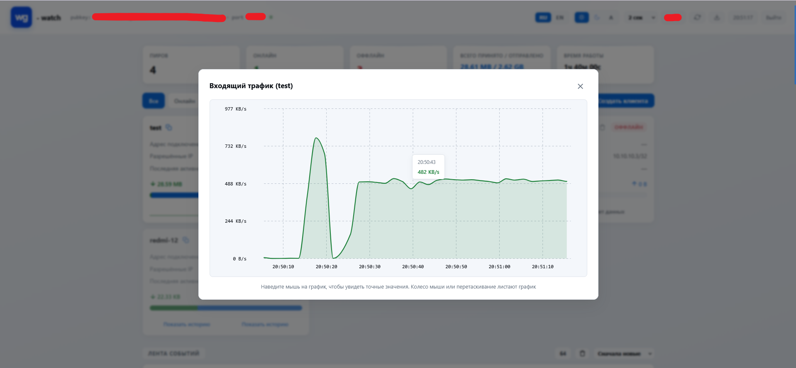
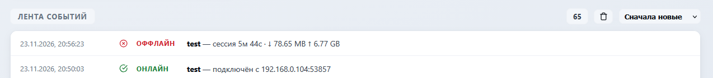

# wg-watch

Небольшой дашборд для своего сервера WireGuard: кто сейчас онлайн, сколько трафика передал, что происходило за ночь. Ведёт журнал событий, шлёт уведомления по почте и умеет создавать и удалять клиентов из браузера.

---

## Прочитайте сначала (это важно)

- **Это личный проект.** Я написал его для своего сервера и своей схемы WireGuard. Он опубликован **«как есть», без гарантий и без поддержки**.
- **Скрипта установки нет.** У всех системы разные, автоматический установщик я не делал и делать не планирую. Установка — это ручная схема (см. [Установка](#установка)). Приготовьтесь читать код, юниты и скрипты и подгонять их под себя.
- **Опыта работы с GitHub у меня почти нет.** Я просто выложил код. Берите, форкайте, копируйте к себе, переделывайте под свои нужды — как угодно. Pull request'ы и issues я не обещаю разбирать (см. [Вклад и поддержка](#вклад-и-поддержка)).
- **Аудита безопасности не было.** Я старался (см. раздел [Безопасность](#безопасность)), но не могу гарантировать, что он безопасен. Использование — на ваш риск.
- **Никогда не выставляйте его в открытый интернет «как есть».** Он меняет конфигурацию VPN-сервера, работает с приватными ключами клиентов, а два его сервиса запускаются от root. Используйте его только из доверенной локальной сети или через сам VPN. Если доступ извне всё же нужен — ставьте за reverse proxy с ограничением по IP и вторым фактором.
- **Сделайте копию `/etc/wireguard` до того, как пробовать управление клиентами.** Скрипты переписывают серверный конфиг и не откатывают изменения при ошибке.
- **Мне помогал Claude.** Значительная часть кода, текстов README и разбора ошибок сделана с помощью Claude (Anthropic). Я проверял и подгонял всё под свой сервер, но имейте это в виду, когда читаете код.
- **Просто хочу поделиться.** Может, кому-то пригодится. Если да — отлично, если нет — тоже нормально.

Если вас это устраивает, читайте дальше.

---

## Что он делает

**Мониторинг**
- Список пиров: online/offline, endpoint, последний handshake, счётчики rx/tx.
- Спарклайны трафика на карточках и большой интерактивный график; история сохраняется между перезапусками.
- Фильтр «Все / Онлайн / Оффлайн», частота обновления 1/2/5/10 с, баннер, если демон мониторинга не работает.

**События**
- Журнал подключений, отключений (с длительностью сессии и трафиком за сессию), смены endpoint (роуминг), сбоев и восстановления опроса WireGuard, создания и удаления клиентов.
- Фильтр, сортировка, скачивание и очистка из интерфейса. Журнал автоматически обрезается по возрасту и по размеру.

**Уведомления**
- Письма о подключении и отключении через системную команду `mail`.
- Защита от «дребезга»: OFFLINE сообщается, только когда он подтверждён в течение заданного времени, плюс паузы между уведомлениями по одному пиру. Неудачная отправка повторяется (настраивается).

**Управление клиентами** (необязательно, рассчитано на одну конкретную схему — см. [Совместимость](#совместимость-и-допущения))
- Создать клиента (свободный IP, ключи, preshared-ключ, конфиг, перезагрузка), удалить клиента, скачать готовый `.conf`.

**Политики** (необязательно)
- Запуск ваших команд, когда подключается первый пир группы и отключается последний (например, запуск и остановка игрового сервера). См. [Политики](#политики).

**Интерфейс**: русский и английский, светлая / тёмная / автоматическая тема.

---

## Как это устроено

Три сервиса и несколько shell-скриптов:

| Компонент | Язык | Роль |
|---|---|---|
| `wg-watch-daemon` | Go | Опрашивает WireGuard через netlink, ведёт события и историю трафика, шлёт почту, выполняет политики, отдаёт локальный HTTP API. |
| `wg-watch-manager` | Go | Небольшой агент: запускает скрипты создания, удаления и выдачи конфига. |
| `wg-watch-web` | Python (Flask, gunicorn) | Вход, API для браузера, сам дашборд (статический HTML/JS/CSS). |

```
Браузер ──HTTPS──> reverse proxy (например nginx, путь /wg-watch/)
                          │
                          ▼
              wg-watch-web (Flask, 127.0.0.1)
              вход · сессии · CSRF · rate-limit
                 │                          │
      X-Daemon-Token                 X-Manager-Token
                 ▼                          ▼
   wg-watch-daemon (127.0.0.1)    wg-watch-manager (127.0.0.1)
   состояние · трафик · события   создать · удалить · конфиг
        │         │                         │
 netlink│         │ файлы                   │ запуск (с таймаутом)
        ▼         ▼                         ▼
   интерфейс  events.log,          scripts/*.sh → lib/wg-clients.sh
   WireGuard  traffic-history      (серверный конфиг, ключи, IP, flock)
```

Принятые решения:
- Браузер никогда не обращается к Go-сервисам напрямую. Они слушают только loopback, а Flask ходит к ним по общему секрету.
- Демон читает состояние WireGuard из ядра (`wgctrl`), не вызывая `wg` и не разбирая текстовый вывод.
- `events.log` принадлежит `root` (режим `0600`). Flask его не читает: ленту и скачивание журнала отдаёт демон через свой API.
- В менеджере нет логики WireGuard: он запускает скрипты и возвращает их JSON. Вся работа с конфигом — в `lib/wg-clients.sh` под одной блокировкой.
- Мониторинг и управление — отдельные процессы: сбой одного не ломает другой.

---

## Безопасность

**Это не «продакшн-готовый» продукт с точки зрения безопасности. Прежде чем ставить его куда-то, где есть хоть какой-то внешний доступ, прочитайте этот раздел полностью.**

Что сделано:

- **Границы сети.** Демон и менеджер слушают `127.0.0.1`. Flask рассчитан на loopback за reverse proxy; заголовок `Host` проверяется по списку разрешённых.
- **Аутентификация между сервисами.** Каждый Go-сервис требует свой токен (`X-Daemon-Token` / `X-Manager-Token`), сравнение за постоянное время. Минимальная длина токена проверяется при старте (с коротким секретом сервис не запускается).
- **Вход.** Один логин и пароль из окружения, сравнение за постоянное время. Cookie сессии: `HttpOnly`, `Secure`, по умолчанию `SameSite=Strict`. Сессии привязаны к «отпечатку» учётных данных, поэтому смена пароля делает старые сессии недействительными. Редирект `?next=` после входа принимает только локальные пути.
- **Защита от перебора.** Бан после нескольких неудачных попыток входа и отдельный rate-limit на создание и удаление клиентов. Счётчики хранятся в памяти или в Redis.
- **CSRF и веб-заголовки.** CSRF-токен в сессии плюс проверка `Origin`/`Referer`, `nosniff`, `Referrer-Policy`, `X-Frame-Options` / `frame-ancestors`, `no-store` для API. Весь динамический текст экранируется перед вставкой. Статика без входа отдаётся только для белого списка расширений.
- **Проверка входных данных.** Имя клиента проверяется на трёх уровнях (Flask, менеджер, скрипты). Скрипты отклоняют аргументы, начинающиеся с `-`, экранируют свой JSON и работают с таймаутом.
- **Разделение прав.** Веб-сервис работает от непривилегированного пользователя с опциями песочницы systemd. Демон (доступ к netlink) и менеджер (правит конфиг WireGuard) работают от root.
- **Политики.** `policy.conf` выполняет команды от root, поэтому демон не загрузит его, если файл не принадлежит root или доступен на запись группе или всем.

Что нужно знать, прежде чем доверять:

- **Независимой проверки безопасности не было. Никакой. Совсем.**
- **Не выставляйте это в открытый интернет.** Это личный инструмент для домашней/доверенной сети, а не сервис для публичного доступа. Если очень надо — только за reverse proxy с whitelist по IP и 2FA на уровне прокси.
- Аутентификация — **один общий аккаунт, без 2FA**. TLS приложение не обрабатывает: рассчитано на reverse proxy.
- Демон и менеджер работают от **root** без дополнительного hardening в приложенных юнитах. После проверки на тестовой установке стоит добавить его (`NoNewPrivileges`, `ProtectHome`, `PrivateTmp` и т. д.).
- Если включить `CLIENT_MAIL_ENABLED=YES`, скрипт создания клиента **присылает готовый `.conf` вместе с приватным и preshared-ключами** вложением по почте. Оставьте `NO`, если ваша почта не остаётся внутри доверенной сети.
- В `index.html` есть несколько встроенных атрибутов `style`, поэтому для строгого CSP потребуется `style-src 'unsafe-inline'` (или перенесите эти стили в CSS). Встроенных скриптов нет.
- Любой, кто получит доступ к дашборду, сможет создавать и удалять VPN-клиентов и скачивать их конфиги.

---

## Требования

- Linux с systemd.
- Утилиты WireGuard (`wg`, `wg-quick`), интерфейс управляется как `wg-quick@<интерфейс>`.
- Go (версия — в `go.mod`) для сборки демона и менеджера.
- Python 3 (разрабатывалось на 3.13) с Flask, requests и gunicorn; `redis` — по желанию.
- `flock`, `awk`, `timeout` (util-linux / coreutils).
- Для почты: команда `mail` из GNU Mailutils и MTA, например postfix (скрипты используют синтаксис `-E 'set sendmail=…'`).
- Reverse proxy для HTTPS (пример для nginx ниже).

---

## Совместимость и допущения

**Мониторинг почти не зависит от вашей схемы.** Демон читает пиров из ядра, ему нужно только имя интерфейса (`WG_IFACE`). Имена клиентов берутся из `<CLIENTS_DIR>/<имя>/public.key`; если такой структуры нет, пиры просто показываются по публичному ключу.

**Управление клиентами рассчитано на одну конкретную схему.** Если у вас иначе, правьте `lib/wg-clients.sh` и `conf/wg-clients.env`:

1. Интерфейс поднимается через `wg-quick` под systemd (`wg-quick@<интерфейс>`).
2. Серверный конфиг — обычный файл wg-quick с секцией `[Interface]`. Клиенты — блоки `[Peer]`, которым предшествует строка-комментарий `# Client <имя>`, с `AllowedIPs = <ip>/32`. Пиры без такого комментария скрипты не считают клиентами (их нельзя удалить из интерфейса), но их адреса пропускаются при выдаче IP.
3. Удаление клиента вырезает блок от `# Client <имя>` до ближайшей пустой строки или следующего комментария `# Client ` — отделяйте блоки пиров пустой строкой.
4. Подсеть клиентов — **IPv4 /24** (`CLIENT_SUBNET_PREFIX` из трёх октетов), каждому клиенту выдаётся `/32` из диапазона `CLIENT_IP_MIN..CLIENT_IP_MAX`. **IPv6 не поддерживается.**
5. Каждый клиент получает свои ключи и preshared-ключ. В сгенерированном клиентском конфиге есть `Address`, `DNS`, `AllowedIPs`, `Endpoint` и `PersistentKeepalive = 20`; всё остальное (MTU и т. п.) нужно добавлять в шаблон в `wgcfg_create`.
6. Файлы клиентов лежат в `<CLIENTS_DIR>/<имя>/{private.key, public.key, preshared.key, wg-<имя>.conf}`.
7. Один интерфейс WireGuard. AmneziaWG и другие форки не проверялись.
8. Скрипты запускаются от root.

Если нужен только мониторинг, запускайте демон и веб-часть. (В текущей версии веб-часть всё равно требует задать `MANAGER_TOKEN`.)

Значения по умолчанию, зашитые в `lib/wg-clients.sh` (DNS, `ALLOWED_IPS`, имя файла публичного ключа сервера), взяты из моей собственной установки. **Всегда задавайте свои значения в `conf/wg-clients.env`.**

---

## Установка

**Установщика нет и не будет.** Ниже — схема, а не инструкция «скопируй-вставь». Подгоните её под свою систему и прочитайте юниты и скрипты, прежде чем запускать что-либо от root.

1. **Поставьте зависимости** из списка [Требования](#требования).
2. **Разместите проект в `/opt/wg-watch`.** Пути зашиты на этот каталог.
3. **Создайте непривилегированного пользователя** для веб-сервиса (`wg-watch`) и сделайте `logs/` и `pids/` доступными ему на запись так, как ожидает юнит веб-сервиса. Файлы `conf/*.env` держите с владельцем `root` и режимом `600`.
4. **Соберите Go-сервисы:**
   ```bash
   cd /opt/wg-watch/src/daemon  && ./build.sh
   cd /opt/wg-watch/src/manager && ./build.sh
   ```
   Бинарники окажутся в `bin/`.
5. **Создайте виртуальное окружение Python** и поставьте Flask, requests и gunicorn (плюс `redis`, если используете). Поправьте `ExecStart` в `systemd/wg-watch-web.service` под свой путь к venv.
6. **Напишите конфиги** в `conf/` (см. [Конфигурация](#конфигурация)). Токены генерируйте командой `openssl rand -base64 32`.
7. **Сделайте копию `/etc/wireguard`**, затем внимательно проверьте `conf/wg-clients.env`.
8. **Установите юниты и запустите сервисы:**
   ```bash
   cp systemd/*.service /etc/systemd/system/
   systemctl daemon-reload
   systemctl enable --now wg-watch-daemon wg-watch-manager wg-watch-web
   ```
9. **Настройте reverse proxy** (пример ниже) и откройте дашборд по адресу `/wg-watch/`.
10. **Проверьте здоровье сервисов:**
    ```bash
    curl -s http://127.0.0.1:18082/healthz     # демон
    curl -s http://127.0.0.1:18083/healthz     # менеджер
    ```

Пример блока nginx (поправьте адрес upstream, подключение заголовков безопасности и CSP):

```nginx
location /wg-watch/ {
    proxy_pass http://127.0.0.1:6060/;
    proxy_http_version 1.1;
    proxy_set_header Host $host;
    proxy_set_header X-Real-IP $remote_addr;
    proxy_set_header X-Forwarded-For $proxy_add_x_forwarded_for;
    proxy_set_header X-Forwarded-Proto $scheme;
    proxy_set_header X-Forwarded-Prefix /wg-watch;
    proxy_buffering off;
    proxy_read_timeout 40s;     # менеджер может отвечать до ~35 с
    # + ваши заголовки безопасности / CSP / ограничение по IP
}
```

`URL_PREFIX` в web env должен совпадать с путём на прокси и с `<base href>` в `index.html` и `login.html`.

---

## Конфигурация

Настройки — переменные окружения, которые systemd загружает из `conf/`:

| Файл | Кто использует |
|---|---|
| `wg-watch-daemon.env` | мониторинг, события, трафик, почта, политики, API демона |
| `wg-watch-manager.env` | адрес менеджера, токен, таймаут скриптов, длина имени |
| `wg-watch-web.env` | вход, сессии, rate-limit, CSRF, прокси, лимиты интерфейса |
| `wg-clients.env` | скрипты клиентов: пути, подсеть, DNS, маршруты, endpoint, почта |
| `policy.conf` | необязательные политики |

Значения, которые должны совпадать между файлами:

- `DAEMON_TOKEN` — одинаковый в env демона и веба; `MANAGER_TOKEN` — одинаковый в env менеджера и веба.
- `CLIENT_NAME_MAX` — одинаковый в менеджере и в вебе (в скриптах жёстко зашит предел 64).
- `CLIENT_SCRIPT_TIMEOUT` (менеджер) должен быть **меньше** `MANAGER_TIMEOUT` (веб).
- `EVENTS_FILE` — одинаковый в `wg-watch-daemon.env` и `wg-clients.env`.
- `URL_PREFIX` — совпадает с путём на прокси и с `<base href>` в HTML.

Размер ленты событий: в web env задаётся, сколько событий показывает интерфейс (`EVENTS_LIMIT`, `EVENTS_LIMIT_PEER`, жёсткий потолок `EVENTS_LIMIT_MAX`); в env демона — размер файла (`EVENTS_MAX_LINES` запускает обрезку до `EVENTS_KEEP_LINES`, которое должно быть меньше; `EVENTS_RETENTION_DAYS` обрезает по возрасту). Держите `EVENTS_KEEP_LINES` не меньше лимитов интерфейса.

Почта: демон использует `MAIL_*` (принимает `true/false`, `YES/NO`, `1/0`); скрипты клиентов используют `CLIENT_MAIL_*` и принимают **только** `YES` / `NO`. Неудачная отправка повторяется (`MAIL_RETRIES`, `MAIL_RETRY_DELAY`, `MAIL_RETRY_MAX_DELAY`); письмо занимает слот очереди, пока не доставлено, поэтому держите `MAIL_QUEUE_SIZE` не меньше 10.

При неверной конфигурации сервисы не запускаются и завершаются с кодом 78 (`EX_CONFIG`).

---

## Политики

`conf/policy.conf` (INI-подобный формат). Без `POLICY_FILE` в env демона функция выключена. Файл должен принадлежать root и не быть доступным на запись группе и всем.

```ini
[minecraft]
peers = 10.10.10.5                  # IP, имя клиента или публичный ключ
online_to_run_command  = systemctl start minecraft     # подключился первый пир группы
offline_to_run_command = systemctl stop minecraft      # отключился последний пир группы
online_skip_if = systemctl is-active --quiet minecraft # код 0 -> online-команда пропускается
offline_only_if_online_ran = yes    # останавливать только то, что запустил демон
offline_delay = 120                 # секунды; отменяется, если пир вернулся
command_timeout = 30
enabled = yes
```

Команды запускаются через `sh -c` от пользователя демона (root). В окружении: `WG_POLICY`, `WG_EVENT` (`online`/`offline`), `WG_PEER_NAME`, `WG_PEER_IP`, `WG_PEER_PUBKEY`. Перечитать без перезапуска: `kill -HUP <pid демона>`. Действия политик пишутся в `logs/policy.log`.

---

## Эксплуатация

- Логи: `logs/` (`wg-watch-daemon.log`, `wg-watch-manager.log`, `wg-watch-web.log`, `events.log`, `policy.log`); вывод сервисов также идёт в journald. `logrotate/wg-watch` раз в неделю ротирует логи сервисов; `events.log` обрезает сам демон.
- Статус: `systemctl status wg-watch-daemon` (и `-manager`, `-web`).
- Коды выхода: `0` — норма, `1` — ошибка, `78` — ошибка конфигурации.
- CLI-скрипты (от root, `--json` для машинного вывода):
  ```bash
  scripts/create-client.sh          --name NAME [--ip IP] [--json]
  scripts/delete-client.sh          --name NAME [--json]
  scripts/download-client-config.sh --name NAME [--json]
  ```

---

## Структура каталога

```
/opt/wg-watch/
├── bin/         собранные бинарники (daemon, manager)
├── conf/        env-файлы, policy.conf
├── data/        traffic-history.json
├── lib/         wg-clients.sh
├── logrotate/   правила ротации логов
├── logs/        логи сервисов, events.log, policy.log
├── pids/        PID- и lock-файлы
├── scripts/     create-client.sh, delete-client.sh, download-client-config.sh
├── src/         исходники Go: daemon/, manager/
├── systemd/     unit-файлы
└── web/         app.py, templates/, static/ (index.html, js/, css/, icons/)
```

---

## Известные ограничения

- Нет отката: если после изменения серверного конфига не удалась перезагрузка WireGuard, изменения остаются на диске.
- Скрипты не делают резервную копию вашего серверного конфига.
- В дашборде можно создавать и удалять клиентов, но не редактировать их.
- Один аккаунт для входа, без 2FA, без ролей.
- Только IPv4-подсеть /24 для клиентов.
- Проверялось только на моей установке (Linux, systemd, `wg-quick`, Python 3.13).

---

## Вклад и поддержка

**Это личный проект, а не продукт с поддержкой.**

- **Форкайте, берите, копируйте, переделывайте — как угодно.** Мне будет приятно, если кому-то пригодится.
- **Issues и pull requests я не обещаю разбирать** — у меня нет на это времени и опыта работы с GitHub. Если что-то не работает — скорее всего, быстрее будет разобраться самому по коду, чем ждать ответа от меня.
- **Опыта работы с GitHub у меня почти нет.** Я просто выложил код. Если вы нашли баг — форкните, поправьте, пользуйтесь. Если хотите поделиться исправлением — pull request, но без гарантий, что я его увижу и вмержу.
- **Помощь пришла от Claude.** Большая часть кода и документации сделана с помощью Claude (Anthropic). Это не отменяет необходимости читать код перед запуском.

## Лицензия

См. [LICENSE](LICENSE). Программа предоставляется **«как есть», без каких-либо гарантий**.

<!-- Добавьте файл LICENSE (например, MIT) перед публикацией и держите эту строку в соответствии с ним. -->

## Скриншоты

### Дашборд

<p align="center">
  
  
</p>

### Клиент онлайн

<p align="center">
  
  
</p>

### График трафика

<p align="center">
  
  
</p>

### Журнал событий

<p align="center">
  
  
</p>

### Вход


### Защита от некорректного имени клиента


### Индикация недоступности демона


