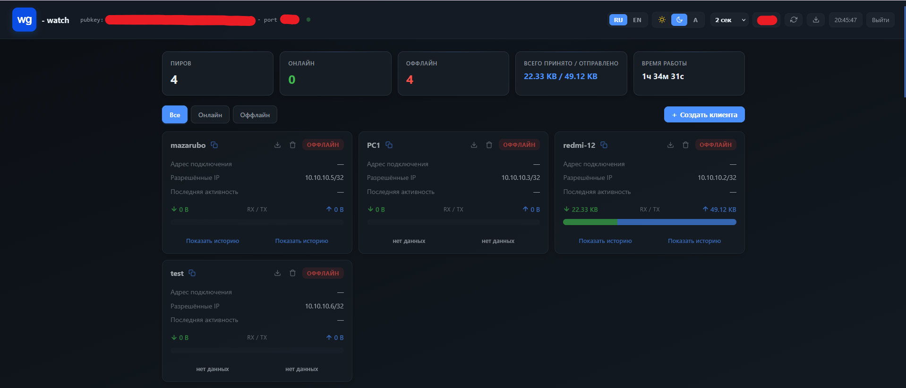
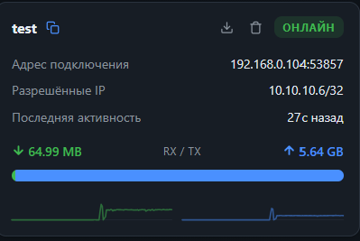
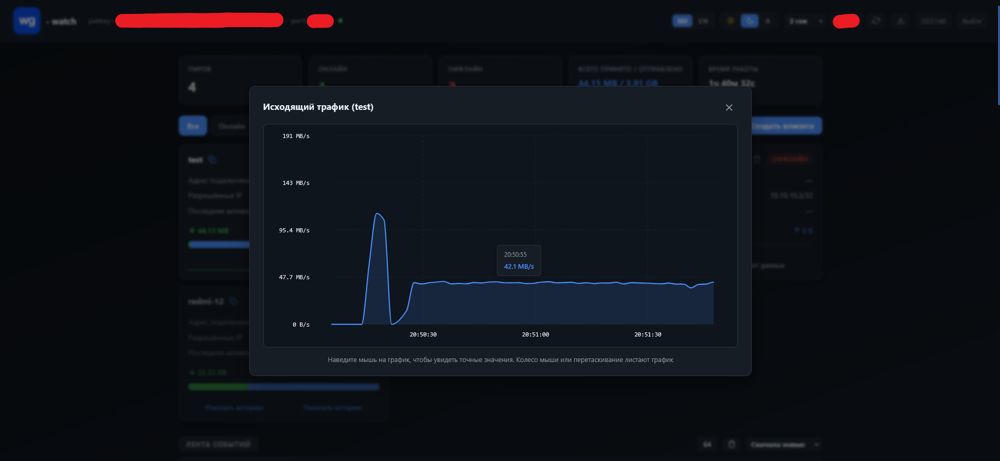
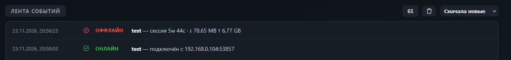
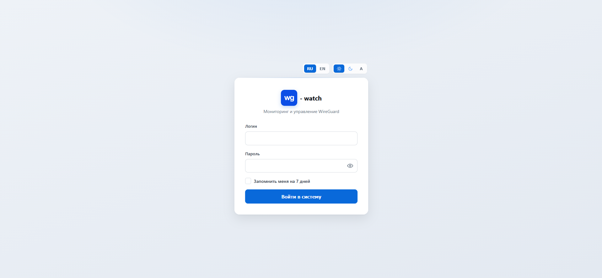
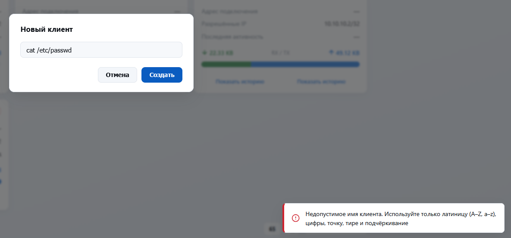
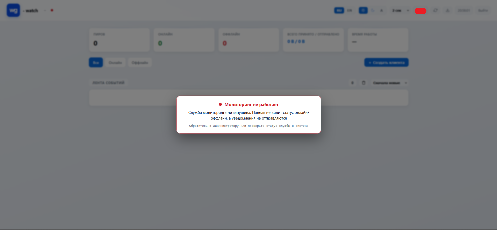

# wg-watch

**English** | [Русский](#русский)

---

<a id="english"></a>

## English

A small dashboard for your own WireGuard server: who is online right now, how much traffic each peer moved, what happened overnight. It keeps an event log, sends email notifications, and lets you create and delete clients from the browser.

### Read this first (it matters)

- **This is a personal project.** I wrote it for my own server and my own WireGuard setup. It is published **as is, with no warranties and no support**.
- **There is no installer.** Everyone's setup is different, so I didn't build an automated installer and don't plan to. Installation is a manual procedure (see [Installation](#installation-en)). Be prepared to read the code, the unit files and the scripts and adapt them to your setup.
- **I have almost no experience with GitHub.** I just uploaded the code. Take it, fork it, copy it, rewrite it however you like. I can't promise to look at issues or pull requests (see [Contributing and support](#contributing-and-support-en)).
- **There has been no security audit.** I tried (see [Security](#security-en)), but I can't guarantee it's safe. Use at your own risk.
- **Never expose it to the public internet as is.** It modifies the VPN server configuration, works with clients' private keys, and two of its services run as root. Use it only from a trusted local network or through the VPN itself. If you really need external access, put it behind a reverse proxy with an IP allowlist and a second factor.
- **Back up `/etc/wireguard` before you try client management.** The scripts rewrite the server config and do not roll back on failure.
- **Claude helped me.** A significant part of the code, the README text and the debugging was done with Claude (Anthropic). I reviewed and adapted everything for my server, but keep that in mind when you read the code.
- **I just want to share it.** Maybe someone will find it useful. If so — great. If not — that's fine too.

If that's acceptable to you, read on.

### What it does

**Monitoring**
- Peer list: online/offline, endpoint, last handshake, rx/tx counters.
- Traffic sparklines on the cards and a large interactive chart; history survives restarts.
- Filter "All / Online / Offline", refresh rate 1/2/5/10 s, a banner if the monitoring daemon is not running.

**Events**
- Log of connects, disconnects (with session duration and session traffic), endpoint changes (roaming), WireGuard polling failures and recoveries, and client creation/deletion.
- Filter, sort, download and clear from the UI. The log is trimmed automatically by age and by size.

**Notifications**
- Emails on connect and disconnect via the system `mail` command.
- Anti-flapping: OFFLINE is reported only after it has been confirmed for a configured duration, plus per-peer cooldowns between notifications. Failed sends are retried (configurable).

**Client management** (optional, tailored to one specific setup — see [Compatibility and assumptions](#compatibility-and-assumptions-en))
- Create a client (free IP, keys, preshared key, config, reload), delete a client, download the finished `.conf`.

**Policies** (optional)
- Run your own commands when the first peer of a group connects and the last one disconnects (e.g. start and stop a game server). See [Policies](#policies-en).

**UI**: Russian and English, light / dark / auto theme.

### How it works

Three services and a few shell scripts:

| Component | Language | Role |
|---|---|---|
| `wg-watch-daemon` | Go | Polls WireGuard over netlink, keeps events and traffic history, sends email, runs policies, exposes a local HTTP API. |
| `wg-watch-manager` | Go | A small agent: runs the create, delete and config-fetch scripts. |
| `wg-watch-web` | Python (Flask, gunicorn) | Login, browser API, the dashboard itself (static HTML/JS/CSS). |

```
Browser ──HTTPS──> reverse proxy (e.g. nginx, path /wg-watch/)
                          │
                          ▼
              wg-watch-web (Flask, 127.0.0.1)
              login · sessions · CSRF · rate-limit
                 │                          │
      X-Daemon-Token                 X-Manager-Token
                 ▼                          ▼
   wg-watch-daemon (127.0.0.1)    wg-watch-manager (127.0.0.1)
   state · traffic · events       create · delete · config
        │         │                         │
 netlink│         │ files                   │ run (with timeout)
        ▼         ▼                         ▼
   WireGuard   events.log,          scripts/*.sh → lib/wg-clients.sh
   interface   traffic-history      (server config, keys, IPs, flock)
```

Design decisions:
- The browser never talks to the Go services directly. They listen on loopback only, and Flask talks to them with a shared secret.
- The daemon reads WireGuard state from the kernel (`wgctrl`) instead of calling `wg` and parsing text output.
- `events.log` is owned by `root` (mode `0600`). Flask does not read it: the event feed and log download are served by the daemon through its API.
- The manager contains no WireGuard logic: it runs scripts and returns their JSON. All config work happens in `lib/wg-clients.sh` under a single lock.
- Monitoring and management are separate processes: a failure in one does not take down the other.

<a id="security-en"></a>

### Security

**This is not a "production-ready" product from a security standpoint. Before you install it anywhere with even minimal external access, read this section in full.**

What has been done:

- **Network boundaries.** The daemon and manager listen on `127.0.0.1`. Flask is designed to run on loopback behind a reverse proxy; the `Host` header is checked against an allowlist.
- **Service-to-service authentication.** Each Go service requires its own token (`X-Daemon-Token` / `X-Manager-Token`), compared in constant time. A minimum token length is enforced at startup (the service refuses to start with a short secret).
- **Login.** A single username and password from the environment, compared in constant time. Session cookie: `HttpOnly`, `Secure`, `SameSite=Strict` by default. Sessions are bound to a credential "fingerprint", so changing the password invalidates old sessions. The `?next=` redirect after login only accepts local paths.
- **Brute-force protection.** A ban after several failed login attempts and a separate rate limit on client create/delete. Counters are stored in memory or in Redis.
- **CSRF and web headers.** A CSRF token in the session plus an `Origin`/`Referer` check, `nosniff`, `Referrer-Policy`, `X-Frame-Options` / `frame-ancestors`, and `no-store` for the API. All dynamic text is escaped before insertion. Unauthenticated static files are served only for an allowlist of extensions.
- **Input validation.** The client name is validated at three levels (Flask, manager, scripts). The scripts reject arguments starting with `-`, escape their JSON, and run with a timeout.
- **Privilege separation.** The web service runs as an unprivileged user with systemd sandboxing options. The daemon (netlink access) and the manager (rewrites the WireGuard config) run as root.
- **Policies.** `policy.conf` runs commands as root, so the daemon refuses to load it if the file is not owned by root or is writable by group or others.

What you need to know before trusting it:

- **There has been no independent security review. None. At all.**
- **Do not expose this to the public internet.** It is a personal tool for a home / trusted network, not a service for public access. If you absolutely must, put it behind a reverse proxy with an IP allowlist and 2FA at the proxy level.
- Authentication is **a single shared account, with no 2FA**. TLS is not handled by the application: it is designed for a reverse proxy.
- The daemon and the manager run as **root** with no additional hardening in the supplied unit files. After testing on a staging install, consider adding it (`NoNewPrivileges`, `ProtectHome`, `PrivateTmp`, etc.).
- If you enable `CLIENT_MAIL_ENABLED=YES`, the client-creation script **emails the finished `.conf` together with the private and preshared keys** as an attachment. Leave it at `NO` unless your mail stays within a trusted network.
- `index.html` uses a few inline `style` attributes, so a strict CSP will need `style-src 'unsafe-inline'` (or you can move those styles into CSS). There are no inline scripts.
- Anyone who gets access to the dashboard can create and delete VPN clients and download their configs.

### Requirements

- Linux with systemd.
- WireGuard tools (`wg`, `wg-quick`), with the interface managed as `wg-quick@<interface>`.
- Go (the version is in `go.mod`) to build the daemon and the manager.
- Python 3 (developed on 3.13) with Flask, requests and gunicorn; `redis` is optional.
- `flock`, `awk`, `timeout` (util-linux / coreutils).
- For email: the `mail` command from GNU Mailutils and an MTA such as postfix (the scripts use the `-E 'set sendmail=…'` syntax).
- A reverse proxy for HTTPS (an nginx example is below).

<a id="compatibility-and-assumptions-en"></a>

### Compatibility and assumptions

**Monitoring has almost no dependency on your setup.** The daemon reads peers from the kernel and only needs the interface name (`WG_IFACE`). Client names come from `<CLIENTS_DIR>/<name>/public.key`; if that layout is absent, peers are simply shown by their public key.

**Client management is tailored to one specific setup.** If yours is different, edit `lib/wg-clients.sh` and `conf/wg-clients.env`:

1. The interface is brought up through `wg-quick` under systemd (`wg-quick@<interface>`).
2. The server config is a plain wg-quick file with an `[Interface]` section. Clients are `[Peer]` blocks preceded by a comment line `# Client <name>`, with `AllowedIPs = <ip>/32`. Peers without such a comment are not treated as clients by the scripts (they cannot be removed from the interface), but their addresses are skipped when allocating IPs.
3. Client deletion cuts the block from `# Client <name>` to the nearest blank line or the next `# Client ` comment — separate peer blocks with a blank line.
4. The client subnet is an **IPv4 /24** (`CLIENT_SUBNET_PREFIX` made of the first three octets); each client gets a `/32` from `CLIENT_IP_MIN..CLIENT_IP_MAX`. **IPv6 is not supported.**
5. Each client gets its own keys and a preshared key. The generated client config contains `Address`, `DNS`, `AllowedIPs`, `Endpoint` and `PersistentKeepalive = 20`; anything else (MTU, etc.) must be added to the template in `wgcfg_create`.
6. Client files live in `<CLIENTS_DIR>/<name>/{private.key, public.key, preshared.key, wg-<name>.conf}`.
7. A single WireGuard interface. AmneziaWG and other forks have not been tested.
8. The scripts run as root.

If you only need monitoring, run the daemon and the web part. (In the current version the web part still requires `MANAGER_TOKEN` to be set.)

The defaults baked into `lib/wg-clients.sh` (DNS, `ALLOWED_IPS`, the server public key file name) come from my own setup. **Always set your own values in `conf/wg-clients.env`.**

<a id="installation-en"></a>

### Installation

**There is no installer and there won't be one.** The steps below are a recipe, not a "copy and paste" instruction. Adapt them to your system and read the unit files and scripts before running anything as root.

1. **Install the dependencies** from [Requirements](#requirements).
2. **Place the project in `/opt/wg-watch`.** Paths are hardcoded to this directory.
3. **Create an unprivileged user** for the web service (`wg-watch`) and make `logs/` and `pids/` writable for it the way the web unit expects. Keep `conf/*.env` files owned by `root` with mode `600`.
4. **Build the Go services:**
   ```bash
   cd /opt/wg-watch/src/daemon  && ./build.sh
   cd /opt/wg-watch/src/manager && ./build.sh
   ```
   The binaries end up in `bin/`.
5. **Create a Python virtual environment** and install Flask, requests and gunicorn (plus `redis` if you use it). Adjust `ExecStart` in `systemd/wg-watch-web.service` to point to your venv.
6. **Write the configs** in `conf/` (see [Configuration](#configuration-en)). Generate tokens with `openssl rand -base64 32`.
7. **Back up `/etc/wireguard`**, then carefully review `conf/wg-clients.env`.
8. **Install the units and start the services:**
   ```bash
   cp systemd/*.service /etc/systemd/system/
   systemctl daemon-reload
   systemctl enable --now wg-watch-daemon wg-watch-manager wg-watch-web
   ```
9. **Configure the reverse proxy** (example below) and open the dashboard at `/wg-watch/`.
10. **Check service health:**
    ```bash
    curl -s http://127.0.0.1:18082/healthz     # daemon
    curl -s http://127.0.0.1:18083/healthz     # manager
    ```

Example nginx block (adjust the upstream address and add the security headers and CSP):

```nginx
location /wg-watch/ {
    proxy_pass http://127.0.0.1:6060/;
    proxy_http_version 1.1;
    proxy_set_header Host $host;
    proxy_set_header X-Real-IP $remote_addr;
    proxy_set_header X-Forwarded-For $proxy_add_x_forwarded_for;
    proxy_set_header X-Forwarded-Proto $scheme;
    proxy_set_header X-Forwarded-Prefix /wg-watch;
    proxy_buffering off;
    proxy_read_timeout 40s;     # the manager may take up to ~35 s to respond
    # + your security headers / CSP / IP allowlist
}
```

`URL_PREFIX` in the web env must match the proxy path and the `<base href>` in `index.html` and `login.html`.

<a id="configuration-en"></a>

### Configuration

Configuration is done through environment variables that systemd loads from `conf/`:

| File | Used by |
|---|---|
| `wg-watch-daemon.env` | monitoring, events, traffic, email, policies, daemon API |
| `wg-watch-manager.env` | manager address, token, script timeout, name length |
| `wg-watch-web.env` | login, sessions, rate-limit, CSRF, proxy, UI limits |
| `wg-clients.env` | client scripts: paths, subnet, DNS, routes, endpoint, email |
| `policy.conf` | optional policies |

Values that must match across files:

- `DAEMON_TOKEN` — identical in the daemon env and the web env; `MANAGER_TOKEN` — identical in the manager env and the web env.
- `CLIENT_NAME_MAX` — identical in the manager and the web env (the scripts hardcode a limit of 64).
- `CLIENT_SCRIPT_TIMEOUT` (manager) must be **less than** `MANAGER_TIMEOUT` (web).
- `EVENTS_FILE` — identical in `wg-watch-daemon.env` and `wg-clients.env`.
- `URL_PREFIX` — must match the proxy path and the `<base href>` in the HTML.

Event feed size: the web env controls how many events the UI shows (`EVENTS_LIMIT`, `EVENTS_LIMIT_PEER`, hard cap `EVENTS_LIMIT_MAX`); the daemon env controls the file size (`EVENTS_MAX_LINES` triggers a trim down to `EVENTS_KEEP_LINES`, which must be smaller; `EVENTS_RETENTION_DAYS` trims by age). Keep `EVENTS_KEEP_LINES` no smaller than the UI limits.

Email: the daemon uses `MAIL_*` (accepts `true/false`, `YES/NO`, `1/0`); the client scripts use `CLIENT_MAIL_*` and accept **only** `YES` / `NO`. Failed sends are retried (`MAIL_RETRIES`, `MAIL_RETRY_DELAY`, `MAIL_RETRY_MAX_DELAY`); a message occupies a queue slot until it is delivered, so keep `MAIL_QUEUE_SIZE` at 10 or more.

On a bad configuration the services refuse to start and exit with code 78 (`EX_CONFIG`).

<a id="policies-en"></a>

### Policies

`conf/policy.conf` (INI-like format). Without `POLICY_FILE` in the daemon env the feature is disabled. The file must be owned by root and not writable by group or others.

```ini
[minecraft]
peers = 10.10.10.5                  # IP, client name or public key
online_to_run_command  = systemctl start minecraft     # the first peer of the group connected
offline_to_run_command = systemctl stop minecraft      # the last peer of the group disconnected
online_skip_if = systemctl is-active --quiet minecraft # exit code 0 -> the online command is skipped
offline_only_if_online_ran = yes    # stop only what the daemon started
offline_delay = 120                 # seconds; cancelled if the peer comes back
command_timeout = 30
enabled = yes
```

Commands are run via `sh -c` as the daemon user (root). The environment contains: `WG_POLICY`, `WG_EVENT` (`online`/`offline`), `WG_PEER_NAME`, `WG_PEER_IP`, `WG_PEER_PUBKEY`. To reload without restarting: `kill -HUP <daemon pid>`. Policy actions are written to `logs/policy.log`.

### Operations

- Logs: `logs/` (`wg-watch-daemon.log`, `wg-watch-manager.log`, `wg-watch-web.log`, `events.log`, `policy.log`); service output also goes to journald. `logrotate/wg-watch` rotates the service logs weekly; `events.log` is trimmed by the daemon itself.
- Status: `systemctl status wg-watch-daemon` (and `-manager`, `-web`).
- Exit codes: `0` — OK, `1` — error, `78` — configuration error.
- CLI scripts (as root, `--json` for machine-readable output):
  ```bash
  scripts/create-client.sh          --name NAME [--ip IP] [--json]
  scripts/delete-client.sh          --name NAME [--json]
  scripts/download-client-config.sh --name NAME [--json]
  ```

### Directory layout

```
/opt/wg-watch/
├── bin/         compiled binaries (daemon, manager)
├── conf/        env files, policy.conf
├── data/        traffic-history.json
├── lib/         wg-clients.sh
├── logrotate/   log rotation rules
├── logs/        service logs, events.log, policy.log
├── pids/        PID and lock files
├── scripts/     create-client.sh, delete-client.sh, download-client-config.sh
├── src/         Go sources: daemon/, manager/
├── systemd/     unit files
└── web/         app.py, templates/, static/ (index.html, js/, css/, icons/)
```

### Known limitations

- No rollback: if the server config was changed but WireGuard failed to reload, the changes stay on disk.
- The scripts do not back up your server config.
- The dashboard can create and delete clients, but not edit them.
- A single login account, no 2FA, no roles.
- Only an IPv4 /24 client subnet.
- Tested only on my setup (Linux, systemd, `wg-quick`, Python 3.13).

<a id="contributing-and-support-en"></a>

### Contributing and support

**This is a personal project, not a supported product.**

- **Fork it, take it, copy it, rewrite it — however you like.** I'll be glad if someone finds it useful.
- **I can't promise to look at issues or pull requests** — I don't have the time, and I don't have much experience with GitHub. If something doesn't work, it's probably faster to figure it out from the code than to wait for an answer from me.
- **I have almost no experience with GitHub.** I just uploaded the code. If you found a bug — fork it, fix it, use it. If you want to share a fix — a pull request is welcome, but with no guarantee that I'll see it and merge it.
- **Claude helped.** Most of the code and documentation was written with the help of Claude (Anthropic). That doesn't remove the need to read the code before running it.

### License

See [LICENSE](LICENSE) — MIT. The software is provided **as is, without any warranties**.

### Screenshots

**Dashboard**

<p align="center">
  
  
</p>

**Peer online**

<p align="center">
  
  
</p>

**Traffic chart**

<p align="center">
  
  
</p>

**Event log**

<p align="center">
  
  
</p>

**Login**



**Invalid client name is rejected**



**Daemon unavailable indicator**



---

<a id="русский"></a>

## Русский

[English](#english) | **Русский**

Небольшой дашборд для своего сервера WireGuard: кто сейчас онлайн, сколько трафика передал, что происходило за ночь. Ведёт журнал событий, шлёт уведомления по почте и умеет создавать и удалять клиентов из браузера.

### Прочитайте сначала (это важно)

- **Это личный проект.** Я написал его для своего сервера и своей схемы WireGuard. Он опубликован **«как есть», без гарантий и без поддержки**.
- **Скрипта установки нет.** У всех системы разные, автоматический установщик я не делал и делать не планирую. Установка — это ручная схема (см. [Установка](#установка-ru)). Приготовьтесь читать код, юниты и скрипты и подгонять их под себя.
- **Опыта работы с GitHub у меня почти нет.** Я просто выложил код. Берите, форкайте, копируйте к себе, переделывайте под свои нужды — как угодно. Pull request'ы и issues я не обещаю разбирать (см. [Вклад и поддержка](#вклад-и-поддержка-ru)).
- **Аудита безопасности не было.** Я старался (см. раздел [Безопасность](#безопасность-ru)), но не могу гарантировать, что он безопасен. Использование — на ваш риск.
- **Никогда не выставляйте его в открытый интернет «как есть».** Он меняет конфигурацию VPN-сервера, работает с приватными ключами клиентов, а два его сервиса запускаются от root. Используйте его только из доверенной локальной сети или через сам VPN. Если доступ извне всё же нужен — ставьте за reverse proxy с ограничением по IP и вторым фактором.
- **Сделайте копию `/etc/wireguard` до того, как пробовать управление клиентами.** Скрипты переписывают серверный конфиг и не откатывают изменения при ошибке.
- **Мне помогал Claude.** Значительная часть кода, текстов README и разбора ошибок сделана с помощью Claude (Anthropic). Я проверял и подгонял всё под свой сервер, но имейте это в виду, когда читаете код.
- **Просто хочу поделиться.** Может, кому-то пригодится. Если да — отлично, если нет — тоже нормально.

Если вас это устраивает, читайте дальше.

### Что он делает

**Мониторинг**
- Список пиров: online/offline, endpoint, последний handshake, счётчики rx/tx.
- Спарклайны трафика на карточках и большой интерактивный график; история сохраняется между перезапусками.
- Фильтр «Все / Онлайн / Оффлайн», частота обновления 1/2/5/10 с, баннер, если демон мониторинга не работает.

**События**
- Журнал подключений, отключений (с длительностью сессии и трафиком за сессию), смены endpoint (роуминг), сбоев и восстановления опроса WireGuard, создания и удаления клиентов.
- Фильтр, сортировка, скачивание и очистка из интерфейса. Журнал автоматически обрезается по возрасту и по размеру.

**Уведомления**
- Письма о подключении и отключении через системную команду `mail`.
- Защита от «дребезга»: OFFLINE сообщается, только когда он подтверждён в течение заданного времени, плюс паузы между уведомлениями по одному пиру. Неудачная отправка повторяется (настраивается).

**Управление клиентами** (необязательно, рассчитано на одну конкретную схему — см. [Совместимость](#совместимость-ru))
- Создать клиента (свободный IP, ключи, preshared-ключ, конфиг, перезагрузка), удалить клиента, скачать готовый `.conf`.

**Политики** (необязательно)
- Запуск ваших команд, когда подключается первый пир группы и отключается последний (например, запуск и остановка игрового сервера). См. [Политики](#политики-ru).

**Интерфейс**: русский и английский, светлая / тёмная / автоматическая тема.

### Как это устроено

Три сервиса и несколько shell-скриптов:

| Компонент | Язык | Роль |
|---|---|---|
| `wg-watch-daemon` | Go | Опрашивает WireGuard через netlink, ведёт события и историю трафика, шлёт почту, выполняет политики, отдаёт локальный HTTP API. |
| `wg-watch-manager` | Go | Небольшой агент: запускает скрипты создания, удаления и выдачи конфига. |
| `wg-watch-web` | Python (Flask, gunicorn) | Вход, API для браузера, сам дашборд (статический HTML/JS/CSS). |

```
Браузер ──HTTPS──> reverse proxy (например nginx, путь /wg-watch/)
                          │
                          ▼
              wg-watch-web (Flask, 127.0.0.1)
              вход · сессии · CSRF · rate-limit
                 │                          │
      X-Daemon-Token                 X-Manager-Token
                 ▼                          ▼
   wg-watch-daemon (127.0.0.1)    wg-watch-manager (127.0.0.1)
   состояние · трафик · события   создать · удалить · конфиг
        │         │                         │
 netlink│         │ файлы                   │ запуск (с таймаутом)
        ▼         ▼                         ▼
   интерфейс  events.log,          scripts/*.sh → lib/wg-clients.sh
   WireGuard  traffic-history      (серверный конфиг, ключи, IP, flock)
```

Принятые решения:
- Браузер никогда не обращается к Go-сервисам напрямую. Они слушают только loopback, а Flask ходит к ним по общему секрету.
- Демон читает состояние WireGuard из ядра (`wgctrl`), не вызывая `wg` и не разбирая текстовый вывод.
- `events.log` принадлежит `root` (режим `0600`). Flask его не читает: ленту и скачивание журнала отдаёт демон через свой API.
- В менеджере нет логики WireGuard: он запускает скрипты и возвращает их JSON. Вся работа с конфигом — в `lib/wg-clients.sh` под одной блокировкой.
- Мониторинг и управление — отдельные процессы: сбой одного не ломает другой.

<a id="безопасность-ru"></a>

### Безопасность

**Это не «продакшн-готовый» продукт с точки зрения безопасности. Прежде чем ставить его куда-то, где есть хоть какой-то внешний доступ, прочитайте этот раздел полностью.**

Что сделано:

- **Границы сети.** Демон и менеджер слушают `127.0.0.1`. Flask рассчитан на loopback за reverse proxy; заголовок `Host` проверяется по списку разрешённых.
- **Аутентификация между сервисами.** Каждый Go-сервис требует свой токен (`X-Daemon-Token` / `X-Manager-Token`), сравнение за постоянное время. Минимальная длина токена проверяется при старте (с коротким секретом сервис не запускается).
- **Вход.** Один логин и пароль из окружения, сравнение за постоянное время. Cookie сессии: `HttpOnly`, `Secure`, по умолчанию `SameSite=Strict`. Сессии привязаны к «отпечатку» учётных данных, поэтому смена пароля делает старые сессии недействительными. Редирект `?next=` после входа принимает только локальные пути.
- **Защита от перебора.** Бан после нескольких неудачных попыток входа и отдельный rate-limit на создание и удаление клиентов. Счётчики хранятся в памяти или в Redis.
- **CSRF и веб-заголовки.** CSRF-токен в сессии плюс проверка `Origin`/`Referer`, `nosniff`, `Referrer-Policy`, `X-Frame-Options` / `frame-ancestors`, `no-store` для API. Весь динамический текст экранируется перед вставкой. Статика без входа отдаётся только для белого списка расширений.
- **Проверка входных данных.** Имя клиента проверяется на трёх уровнях (Flask, менеджер, скрипты). Скрипты отклоняют аргументы, начинающиеся с `-`, экранируют свой JSON и работают с таймаутом.
- **Разделение прав.** Веб-сервис работает от непривилегированного пользователя с опциями песочницы systemd. Демон (доступ к netlink) и менеджер (правит конфиг WireGuard) работают от root.
- **Политики.** `policy.conf` выполняет команды от root, поэтому демон не загрузит его, если файл не принадлежит root или доступен на запись группе или всем.

Что нужно знать, прежде чем доверять:

- **Независимой проверки безопасности не было. Никакой. Совсем.**
- **Не выставляйте это в открытый интернет.** Это личный инструмент для домашней/доверенной сети, а не сервис для публичного доступа. Если очень надо — только за reverse proxy с whitelist по IP и 2FA на уровне прокси.
- Аутентификация — **один общий аккаунт, без 2FA**. TLS приложение не обрабатывает: рассчитано на reverse proxy.
- Демон и менеджер работают от **root** без дополнительного hardening в приложенных юнитах. После проверки на тестовой установке стоит добавить его (`NoNewPrivileges`, `ProtectHome`, `PrivateTmp` и т. д.).
- Если включить `CLIENT_MAIL_ENABLED=YES`, скрипт создания клиента **присылает готовый `.conf` вместе с приватным и preshared-ключами** вложением по почте. Оставьте `NO`, если ваша почта не остаётся внутри доверенной сети.
- В `index.html` есть несколько встроенных атрибутов `style`, поэтому для строгого CSP потребуется `style-src 'unsafe-inline'` (или перенесите эти стили в CSS). Встроенных скриптов нет.
- Любой, кто получит доступ к дашборду, сможет создавать и удалять VPN-клиентов и скачивать их конфиги.

### Требования

- Linux с systemd.
- Утилиты WireGuard (`wg`, `wg-quick`), интерфейс управляется как `wg-quick@<интерфейс>`.
- Go (версия — в `go.mod`) для сборки демона и менеджера.
- Python 3 (разрабатывалось на 3.13) с Flask, requests и gunicorn; `redis` — по желанию.
- `flock`, `awk`, `timeout` (util-linux / coreutils).
- Для почты: команда `mail` из GNU Mailutils и MTA, например postfix (скрипты используют синтаксис `-E 'set sendmail=…'`).
- Reverse proxy для HTTPS (пример для nginx ниже).

<a id="совместимость-ru"></a>

### Совместимость и допущения

**Мониторинг почти не зависит от вашей схемы.** Демон читает пиров из ядра, ему нужно только имя интерфейса (`WG_IFACE`). Имена клиентов берутся из `<CLIENTS_DIR>/<имя>/public.key`; если такой структуры нет, пиры просто показываются по публичному ключу.

**Управление клиентами рассчитано на одну конкретную схему.** Если у вас иначе, правьте `lib/wg-clients.sh` и `conf/wg-clients.env`:

1. Интерфейс поднимается через `wg-quick` под systemd (`wg-quick@<интерфейс>`).
2. Серверный конфиг — обычный файл wg-quick с секцией `[Interface]`. Клиенты — блоки `[Peer]`, которым предшествует строка-комментарий `# Client <имя>`, с `AllowedIPs = <ip>/32`. Пиры без такого комментария скрипты не считают клиентами (их нельзя удалить из интерфейса), но их адреса пропускаются при выдаче IP.
3. Удаление клиента вырезает блок от `# Client <имя>` до ближайшей пустой строки или следующего комментария `# Client ` — отделяйте блоки пиров пустой строкой.
4. Подсеть клиентов — **IPv4 /24** (`CLIENT_SUBNET_PREFIX` из трёх октетов), каждому клиенту выдаётся `/32` из диапазона `CLIENT_IP_MIN..CLIENT_IP_MAX`. **IPv6 не поддерживается.**
5. Каждый клиент получает свои ключи и preshared-ключ. В сгенерированном клиентском конфиге есть `Address`, `DNS`, `AllowedIPs`, `Endpoint` и `PersistentKeepalive = 20`; всё остальное (MTU и т. п.) нужно добавлять в шаблон в `wgcfg_create`.
6. Файлы клиентов лежат в `<CLIENTS_DIR>/<имя>/{private.key, public.key, preshared.key, wg-<имя>.conf}`.
7. Один интерфейс WireGuard. AmneziaWG и другие форки не проверялись.
8. Скрипты запускаются от root.

Если нужен только мониторинг, запускайте демон и веб-часть. (В текущей версии веб-часть всё равно требует задать `MANAGER_TOKEN`.)

Значения по умолчанию, зашитые в `lib/wg-clients.sh` (DNS, `ALLOWED_IPS`, имя файла публичного ключа сервера), взяты из моей собственной установки. **Всегда задавайте свои значения в `conf/wg-clients.env`.**

<a id="установка-ru"></a>

### Установка

**Установщика нет и не будет.** Ниже — схема, а не инструкция «скопируй-вставь». Подгоните её под свою систему и прочитайте юниты и скрипты, прежде чем запускать что-либо от root.

1. **Поставьте зависимости** из списка [Требования](#требования).
2. **Разместите проект в `/opt/wg-watch`.** Пути зашиты на этот каталог.
3. **Создайте непривилегированного пользователя** для веб-сервиса (`wg-watch`) и сделайте `logs/` и `pids/` доступными ему на запись так, как ожидает юнит веб-сервиса. Файлы `conf/*.env` держите с владельцем `root` и режимом `600`.
4. **Соберите Go-сервисы:**
   ```bash
   cd /opt/wg-watch/src/daemon  && ./build.sh
   cd /opt/wg-watch/src/manager && ./build.sh
   ```
   Бинарники окажутся в `bin/`.
5. **Создайте виртуальное окружение Python** и поставьте Flask, requests и gunicorn (плюс `redis`, если используете). Поправьте `ExecStart` в `systemd/wg-watch-web.service` под свой путь к venv.
6. **Напишите конфиги** в `conf/` (см. [Конфигурация](#конфигурация-ru)). Токены генерируйте командой `openssl rand -base64 32`.
7. **Сделайте копию `/etc/wireguard`**, затем внимательно проверьте `conf/wg-clients.env`.
8. **Установите юниты и запустите сервисы:**
   ```bash
   cp systemd/*.service /etc/systemd/system/
   systemctl daemon-reload
   systemctl enable --now wg-watch-daemon wg-watch-manager wg-watch-web
   ```
9. **Настройте reverse proxy** (пример ниже) и откройте дашборд по адресу `/wg-watch/`.
10. **Проверьте здоровье сервисов:**
    ```bash
    curl -s http://127.0.0.1:18082/healthz     # демон
    curl -s http://127.0.0.1:18083/healthz     # менеджер
    ```

Пример блока nginx (поправьте адрес upstream, подключение заголовков безопасности и CSP):

```nginx
location /wg-watch/ {
    proxy_pass http://127.0.0.1:6060/;
    proxy_http_version 1.1;
    proxy_set_header Host $host;
    proxy_set_header X-Real-IP $remote_addr;
    proxy_set_header X-Forwarded-For $proxy_add_x_forwarded_for;
    proxy_set_header X-Forwarded-Proto $scheme;
    proxy_set_header X-Forwarded-Prefix /wg-watch;
    proxy_buffering off;
    proxy_read_timeout 40s;     # менеджер может отвечать до ~35 с
    # + ваши заголовки безопасности / CSP / ограничение по IP
}
```

`URL_PREFIX` в web env должен совпадать с путём на прокси и с `<base href>` в `index.html` и `login.html`.

<a id="конфигурация-ru"></a>

### Конфигурация

Настройки — переменные окружения, которые systemd загружает из `conf/`:

| Файл | Кто использует |
|---|---|
| `wg-watch-daemon.env` | мониторинг, события, трафик, почта, политики, API демона |
| `wg-watch-manager.env` | адрес менеджера, токен, таймаут скриптов, длина имени |
| `wg-watch-web.env` | вход, сессии, rate-limit, CSRF, прокси, лимиты интерфейса |
| `wg-clients.env` | скрипты клиентов: пути, подсеть, DNS, маршруты, endpoint, почта |
| `policy.conf` | необязательные политики |

Значения, которые должны совпадать между файлами:

- `DAEMON_TOKEN` — одинаковый в env демона и веба; `MANAGER_TOKEN` — одинаковый в env менеджера и веба.
- `CLIENT_NAME_MAX` — одинаковый в менеджере и в вебе (в скриптах жёстко зашит предел 64).
- `CLIENT_SCRIPT_TIMEOUT` (менеджер) должен быть **меньше** `MANAGER_TIMEOUT` (веб).
- `EVENTS_FILE` — одинаковый в `wg-watch-daemon.env` и `wg-clients.env`.
- `URL_PREFIX` — совпадает с путём на прокси и с `<base href>` в HTML.

Размер ленты событий: в web env задаётся, сколько событий показывает интерфейс (`EVENTS_LIMIT`, `EVENTS_LIMIT_PEER`, жёсткий потолок `EVENTS_LIMIT_MAX`); в env демона — размер файла (`EVENTS_MAX_LINES` запускает обрезку до `EVENTS_KEEP_LINES`, которое должно быть меньше; `EVENTS_RETENTION_DAYS` обрезает по возрасту). Держите `EVENTS_KEEP_LINES` не меньше лимитов интерфейса.

Почта: демон использует `MAIL_*` (принимает `true/false`, `YES/NO`, `1/0`); скрипты клиентов используют `CLIENT_MAIL_*` и принимают **только** `YES` / `NO`. Неудачная отправка повторяется (`MAIL_RETRIES`, `MAIL_RETRY_DELAY`, `MAIL_RETRY_MAX_DELAY`); письмо занимает слот очереди, пока не доставлено, поэтому держите `MAIL_QUEUE_SIZE` не меньше 10.

При неверной конфигурации сервисы не запускаются и завершаются с кодом 78 (`EX_CONFIG`).

<a id="политики-ru"></a>

### Политики

`conf/policy.conf` (INI-подобный формат). Без `POLICY_FILE` в env демона функция выключена. Файл должен принадлежать root и не быть доступным на запись группе и всем.

```ini
[minecraft]
peers = 10.10.10.5                  # IP, имя клиента или публичный ключ
online_to_run_command  = systemctl start minecraft     # подключился первый пир группы
offline_to_run_command = systemctl stop minecraft      # отключился последний пир группы
online_skip_if = systemctl is-active --quiet minecraft # код 0 -> online-команда пропускается
offline_only_if_online_ran = yes    # останавливать только то, что запустил демон
offline_delay = 120                 # секунды; отменяется, если пир вернулся
command_timeout = 30
enabled = yes
```

Команды запускаются через `sh -c` от пользователя демона (root). В окружении: `WG_POLICY`, `WG_EVENT` (`online`/`offline`), `WG_PEER_NAME`, `WG_PEER_IP`, `WG_PEER_PUBKEY`. Перечитать без перезапуска: `kill -HUP <pid демона>`. Действия политик пишутся в `logs/policy.log`.

### Эксплуатация

- Логи: `logs/` (`wg-watch-daemon.log`, `wg-watch-manager.log`, `wg-watch-web.log`, `events.log`, `policy.log`); вывод сервисов также идёт в journald. `logrotate/wg-watch` раз в неделю ротирует логи сервисов; `events.log` обрезает сам демон.
- Статус: `systemctl status wg-watch-daemon` (и `-manager`, `-web`).
- Коды выхода: `0` — норма, `1` — ошибка, `78` — ошибка конфигурации.
- CLI-скрипты (от root, `--json` для машинного вывода):
  ```bash
  scripts/create-client.sh          --name NAME [--ip IP] [--json]
  scripts/delete-client.sh          --name NAME [--json]
  scripts/download-client-config.sh --name NAME [--json]
  ```

### Структура каталога

```
/opt/wg-watch/
├── bin/         собранные бинарники (daemon, manager)
├── conf/        env-файлы, policy.conf
├── data/        traffic-history.json
├── lib/         wg-clients.sh
├── logrotate/   правила ротации логов
├── logs/        логи сервисов, events.log, policy.log
├── pids/        PID- и lock-файлы
├── scripts/     create-client.sh, delete-client.sh, download-client-config.sh
├── src/         исходники Go: daemon/, manager/
├── systemd/     unit-файлы
└── web/         app.py, templates/, static/ (index.html, js/, css/, icons/)
```

### Известные ограничения

- Нет отката: если после изменения серверного конфига не удалась перезагрузка WireGuard, изменения остаются на диске.
- Скрипты не делают резервную копию вашего серверного конфига.
- В дашборде можно создавать и удалять клиентов, но не редактировать их.
- Один аккаунт для входа, без 2FA, без ролей.
- Только IPv4-подсеть /24 для клиентов.
- Проверялось только на моей установке (Linux, systemd, `wg-quick`, Python 3.13).

<a id="вклад-и-поддержка-ru"></a>

### Вклад и поддержка

**Это личный проект, а не продукт с поддержкой.**

- **Форкайте, берите, копируйте, переделывайте — как угодно.** Мне будет приятно, если кому-то пригодится.
- **Issues и pull requests я не обещаю разбирать** — у меня нет на это времени и опыта работы с GitHub. Если что-то не работает — скорее всего, быстрее будет разобраться самому по коду, чем ждать ответа от меня.
- **Опыта работы с GitHub у меня почти нет.** Я просто выложил код. Если вы нашли баг — форкните, поправьте, пользуйтесь. Если хотите поделиться исправлением — pull request, но без гарантий, что я его увижу и вмержу.
- **Помощь пришла от Claude.** Большая часть кода и документации сделана с помощью Claude (Anthropic). Это не отменяет необходимости читать код перед запуском.

### Лицензия

См. [LICENSE](LICENSE) — MIT. Программа предоставляется **«как есть», без каких-либо гарантий**.

### Скриншоты

**Дашборд**

<p align="center">
  
  
</p>

**Клиент онлайн**

<p align="center">
  
  
</p>

**График трафика**

<p align="center">
  
  
</p>

**Журнал событий**

<p align="center">
  
  
</p>

**Вход**


**Защита от некорректного имени клиента**


**Индикация недоступности демона**


```

---

## Важные замечания по якорям

Я использовал явные `<a id="...">` для всех заголовков, на которые есть перекрёстные ссылки. Это сделано потому, что **автоматические якоря GitHub для кириллицы работают нестабильно** — иногда ссылка `[текст](#безопасность)` «съезжает» в `#безопасность-ru` или вообще ломается. Явные `<a id="...">` это обходят.

Что нужно знать:

1. **Английские якоря** (`#security-en`, `#installation-en` и т. д.) — работают без проблем.
2. **Русские якоря** — я задал их явно (`#безопасность-ru`, `#установка-ru` и т. д.), и все ссылки в тексте указывают именно на них.
3. **Переключатель вверху** — `[Русский](#русский)` ведёт к `<a id="русский">`, который стоит перед русским разделом.
4. **Переключатель в русском разделе** — `[English](#english)` ведёт обратно к английскому.

Единственный минус: в оглавлении GitHub (если оно появится в будущем или если кто-то будет смотреть в TOC) заголовки покажутся как обычные H2/H3 — но это не проблема, весь текст читаемый и все ссылки работают.

Если хотите, могу убрать `<a id="...">`-обёртки и оставить «чистый Markdown» — тогда ссылки будут работать через авто-генерацию GitHub, но для кириллицы это менее надёжно. Скажите, если нужно.
